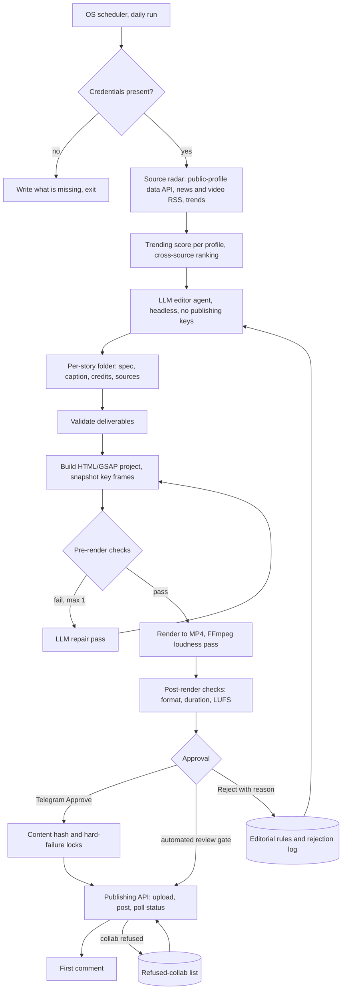

# AI News Desk

An automated newsroom: sources in, checked vertical news videos out, published with credits.

Case study · Python · FFmpeg · LLM agents · HTML/GSAP video templates · Telegram Bot API · OpenCV

## The problem

A social news page lives on speed and accuracy. Every day someone must watch dozens of sources, pick the news, write it, cut a 9:16 video, check it and post it with credits. This project automates that loop and keeps a gate before anything goes live. Sources, editorial rules and templates are inputs, so the same pipeline can run a page about politics, gaming, a company or a sports league.

## Architecture

## Engineering decisions

- **The agent writes, the orchestrator publishes.** The LLM reads third-party captions and web pages, so it runs headless with no tool servers and a permission classifier. Publishing, chat and data API keys are stripped from its environment, and its prompt treats third-party text as data. Only the Python orchestrator holds posting keys.
- **Telegram approval is bound to a content hash.** At review time the system stores a SHA-256 of the video, caption and collaborator list. Publishing refuses if any of them changed. Nine failure types from the quality check block publishing even after an Approve.
- **Face coverage is measured by rendering twice.** The same frames are captured with and without the overlay. The pixel difference is the overlay's exact footprint. Three voting Haar cascades find faces on the clean frame. The check reuses the real template runtime, so no layout math is duplicated.
- **"Trending" is relative to each profile.** A post must reach a multiple of the profile's hourly median and also pass its total median. On a measured sample of 131 posts, the per-hour rule alone flagged 42% of new posts. A collab post is measured against its owner's posts.
- **Loudness is measured after normalising.** Single-pass loudnorm misses -14 LUFS on short clips, so the render measures the result and corrects with a fixed gain.

## How it stays up

- The quality check has 17 categories, from text limits, hashtags, source line and forbidden mentions to format, loudness and face coverage.
- Each step records its result atomically in a per-day state file. A rerun skips finished steps and reuses a radar under six hours old.
- File locks allow one run and one Telegram poller at a time, since two pollers steal clicks.
- The scheduler retries once after 30 minutes. The approval watcher restarts at logon and every 30 minutes, so a reboot keeps pending clicks.
- Data API batches retry once, LLM runs time out, and a failing extra source becomes a warning.
- A rejection reason typed in Telegram goes into a rules file that the next run reads.
- When the platform refuses a collaborator, the handle is parsed from the error and stored. Later posts drop it from the invite and mention it in the first comment.
- After 27 hours without a finished run, the bot sends one alert a day.
- 14 test files hold 248 test functions. The approval flow runs against a fake bot in temporary folders.

## Adapting it to another niche

Configuration covers the source list (section headers drive rotation and "never tag" lists), extra feeds and searches, page name, posts per day, trending thresholds, model, timeouts, approvers, platforms and posting interval. Editorial rules are Markdown files. Layouts are HTML/JS templates.

Some code still needs edits: the run prompt holds page-specific rules, transcription and a few text checks assume Portuguese, a topic keyword filter sits in one module, and two scripts fix the publishing account.

## Known limits

- It runs on a single Windows PC.
- In the agent-driven path, the automated gate is an LLM applying a written checklist kept outside the repository.
- The face detector misses dark, profile and group shots, so a miss is only a warning.
- Post performance is not read back yet. A future step is to feed metrics into story selection and move account and language settings into config.

## Stack

| Layer | Choice |
|---|---|
| Language | Python 3 |
| LLM agent | Claude Code, headless, stream-JSON logs |
| Video | HyperFrames (HTML to video, headless Chrome), GSAP, FFmpeg |
| Vision and speech | OpenCV, NumPy, Pillow, faster-whisper |
| Sources | Public-profile data API, news, video and trends RSS |
| Approval | Telegram Bot API, inline buttons |
| Publishing | Social publishing REST API: uploads, Reels with collab invites, comments |
| State | JSON with atomic writes, TSV registry |
| Scheduling | Windows Task Scheduler, PowerShell |

Built solo with AI assistance (Claude Code).

Source code is private. Happy to walk through it in a call.
